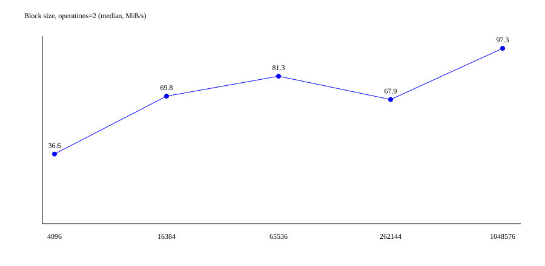
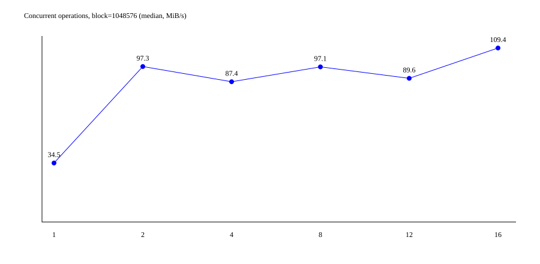
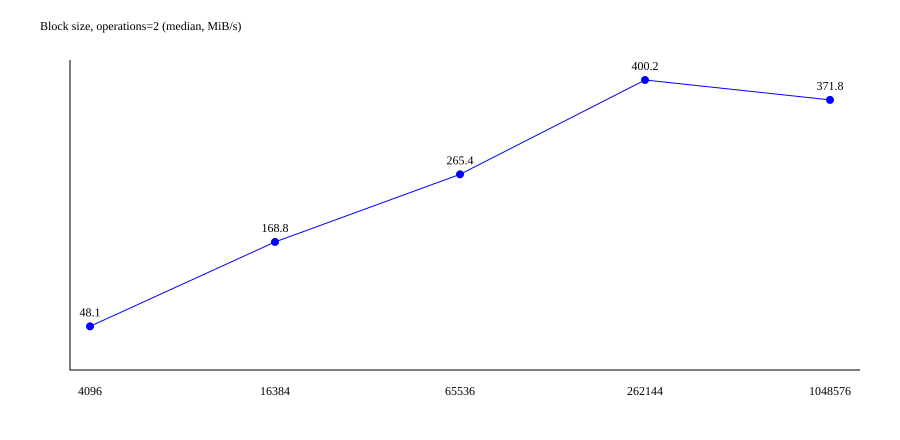
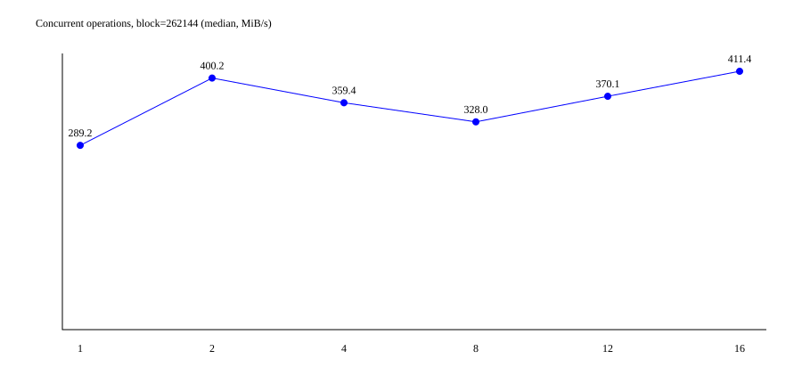
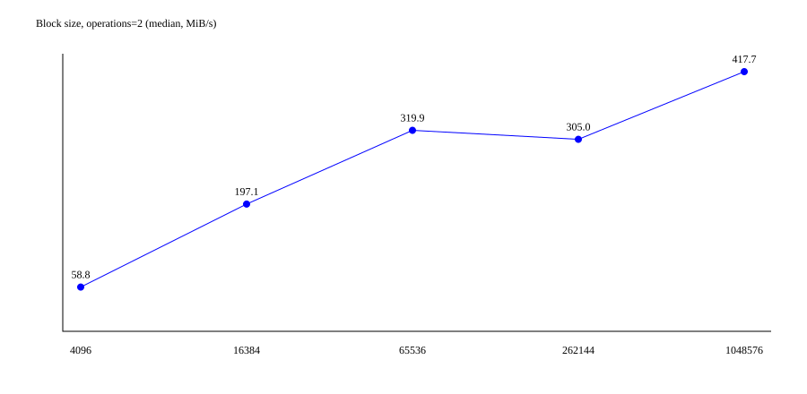
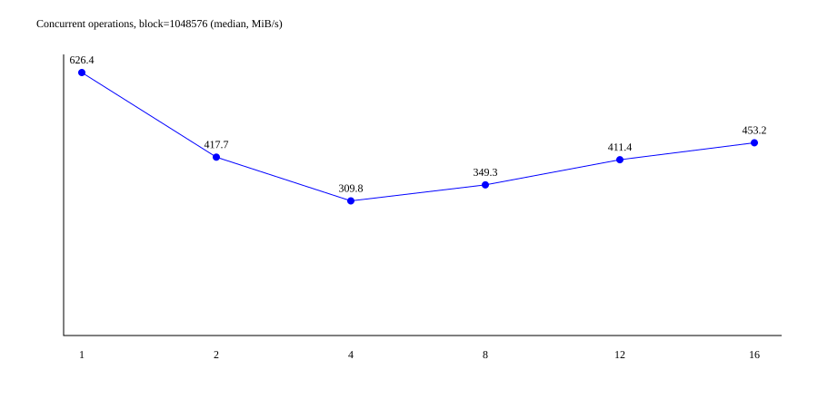

# Отчёт. Работа 1 — управление файловой системой

## Цель

Исследовать управление дисками, каталогами и файлами через Win32 API и асинхронное копирование через POSIX AIO в Linux.

## Задание 1.1

Реализовано консольное приложение C++17 с 14 отдельными пунктами меню и выходом. Список дисков получается двумя способами: битовая маска `GetLogicalDrives` и список строк `GetLogicalDriveStringsW`. `GetDriveTypeW` возвращает числовой тип носителя; `GetVolumeInformationW` — метку, файловую систему, серийный номер, ограничения имени и флаги. `GetDiskFreeSpaceW` возвращает числа кластеров и геометрию; при вычислении байтов используется 64-битное умножение.

`CreateDirectoryW` создаёт один уровень каталога. `RemoveDirectoryW` удаляет только пустой каталог. `CreateFileW` с `CREATE_NEW` исключает случайную перезапись. `CopyFileW` с TRUE и `MoveFileW` отклоняют совпадение имён назначения. Для `MoveFileExW` замена разрешается только после ввода `yes`. Ошибки не прекращают работу меню; выводится код `GetLastError`.

`GetFileAttributesW` выводит маску и основные признаки; `SetFileAttributesW` задаёт новую маску. Следовательно, при изменении одного бита пользователь должен сохранить остальные необходимые признаки. `GetFileInformationByHandle` возвращает размер, число ссылок и идентификатор. `GetFileTime` читает три времени; `SetFileTime` изменяет время последней записи с сохранением остальных. Даты вводятся и выводятся в UTC. Дескрипторы закрываются RAII-объектом.

### Фактический протокол Windows, 19.10.2026

Компилятор `C:\msys64\ucrt64\bin\g++.exe`, C++17, `-Wall -Wextra -Wpedantic`. Сборка успешна без предупреждений. Полный вывод: `windows-test-log.txt`. Использованы относительные ASCII-пути, чтобы избежать преобразования кириллицы при перенаправлении ввода PowerShell.

| Проверка | Результат |
|---|---|
| Оба способа перечисления дисков | Успешно |
| Информация о C: | Кластер 4096 байт; полный размер 1023281197056 байт |
| Создание каталогов a, b | Успешно |
| Создание source.txt и повторная попытка | Успех, затем ошибка 80 (файл существует) |
| Копирование и повторное копирование | Успех, затем ошибка 80 |
| MoveFile в свободное имя | Успешно |
| MoveFileEx в существующее имя без замены | Ошибка 183 |
| Чтение атрибутов, установка readonly, повторное чтение | Маска 32 → 1; readonly=1 |
| Снятие readonly | Успешно, маска NORMAL=128 |
| Информация по дескриптору | Размер 0 байт, число ссылок 1 |
| Чтение и изменение времени записи | Установлено и прочитано 2025-01-02 03:04:05 UTC |
| Удаление непустого каталога | Ошибка 145 |
| Удаление отсутствующего каталога | Ошибка 2 |

Файлы в этом наборе пустые: здесь проверяются операции управления, а не пропускная способность. Значения свободного места зависят от текущей нагрузки системы.

Дополнительный набор (`windows-test-log-additional.txt`): скопирован непустой текстовый файл, выполнен `MoveFileExW` с заменой существующего назначения; SHA-256 источника и результата совпал. Создание и удаление пустого каталога выполнены успешно. Нечисловой пункт меню вызвал обработанную ошибку ввода, приложение продолжило работу.

## Задание 1.2

Исходник `aio_copy.cpp` использует `open` с `O_NONBLOCK`, `fstat`, `aio_read`, `aio_write`, `aio_error`, `aio_return`, `aio_suspend`. Для создания назначения выбран `O_EXCL` вместо `O_TRUNC`: существующий файл, в том числе источник под другим именем, не уничтожается. Ошибка оставляет частичный файл назначения для диагностики; перед повторным запуском его нужно удалить или выбрать другое имя.

Каждый слот содержит `aiocb`, буфер, признак записи и состояние передачи. После чтения слот отправляет запись по тому же смещению; после записи получает следующий блок. Короткие передачи продолжаются с поправкой смещения. Для каждого завершённого запроса `aio_return` вызывается ровно один раз. При ошибке активные запросы отменяются и дожидаются завершения до освобождения буферов. Пустой файл создаётся без AIO-запросов. По завершении вызывается `fsync`.

Уведомления отключены (`SIGEV_NONE`). Функция завершения вызывается основным циклом после `aio_error`, а не отдельным потоком. Такой диспетчер не требует синхронизации полей слота. `next_operation` оставлено в рекомендованной структуре, но пулом владеет вектор, поэтому поле не используется.

### Эксперимент: фактические результаты 19.10.2026

Среда: Ubuntu 24.04.5 LTS, WSL2, ядро 5.15.167.4, g++ 13.3.0,
Intel Core i7-11800H, 16 логических процессоров. Временные исходники и
назначения размещались на ext4 внутри виртуального диска WSL2 (/tmp).
Сборка C++17 с -O2 -Wall -Wextra -Wpedantic успешна. Единственное
предупреждение относится к нулевому массиву __pad внутри системного aiocb glibc.
Полные параметры среды: results/environment.txt; протокол сборки: results/build.txt.

Для каждого размера выполнены 90 копирований: пять блоков × шесть n × три
повтора. Каждая копия проверена cmp и SHA-256. Дополнительно для каждой серии
выполнено 36 граничных проверок и пять проверок отказа. Всего 270 измерений
и 123 дополнительных проверки. Все завершились успешно.

Ниже скорости — медианы трёх повторов, МиБ/с. Время включает fsync.
Кэш не очищался: это характеристика приложения и файловой системы в WSL2,
а не измерение паспортной скорости физического SSD. Порядок испытаний
фиксированный, поэтому возможен эффект прогрева кэша.

#### Файл 1 МиБ

| Блок, байт | n=1 | n=2 | n=4 | n=8 | n=12 | n=16 |

|---|---|---|---|---|---|---|

| 4096 | 25.31 | 36.58 | 44.02 | 45.66 | 55.42 | 53.49 |

| 16384 | 55.99 | 69.84 | 72.54 | 69.76 | 71.16 | 70.71 |

| 65536 | 74.95 | 81.32 | 100.02 | 53.95 | 53.44 | 52.54 |

| 262144 | 48.33 | 67.90 | 93.22 | 108.32 | 103.10 | 107.59 |

| 1048576 | 34.50 | 97.31 | 87.42 | 97.09 | 89.64 | 109.38 |

При n=2 лучший блок: 1048576 байт. Для него лучший n=16, скорость 109.38 МиБ/с. Максимум всей сетки: блок 1048576, n=16, 109.38 МиБ/с.

#### Файл 16 МиБ

| Блок, байт | n=1 | n=2 | n=4 | n=8 | n=12 | n=16 |

|---|---|---|---|---|---|---|

| 4096 | 30.10 | 48.11 | 57.26 | 64.58 | 75.32 | 74.51 |

| 16384 | 106.50 | 168.76 | 125.97 | 146.56 | 155.26 | 135.90 |

| 65536 | 219.39 | 265.37 | 290.28 | 274.14 | 305.12 | 316.57 |

| 262144 | 289.20 | 400.19 | 359.44 | 327.96 | 370.14 | 411.37 |

| 1048576 | 362.93 | 371.75 | 394.94 | 355.26 | 372.43 | 378.80 |

При n=2 лучший блок: 262144 байт. Для него лучший n=16, скорость 411.37 МиБ/с. Максимум всей сетки: блок 262144, n=16, 411.37 МиБ/с.

#### Файл 64 МиБ

| Блок, байт | n=1 | n=2 | n=4 | n=8 | n=12 | n=16 |

|---|---|---|---|---|---|---|

| 4096 | 32.64 | 58.80 | 76.54 | 77.99 | 80.47 | 85.08 |

| 16384 | 86.09 | 197.06 | 171.40 | 156.90 | 126.99 | 156.11 |

| 65536 | 238.04 | 319.92 | 427.18 | 453.25 | 398.94 | 326.51 |

| 262144 | 197.91 | 304.95 | 315.09 | 317.40 | 643.60 | 695.90 |

| 1048576 | 626.42 | 417.70 | 309.80 | 349.32 | 411.36 | 453.17 |

При n=2 лучший блок: 1048576 байт. Для него лучший n=1, скорость 626.42 МиБ/с. Максимум всей сетки: блок 262144, n=16, 695.90 МиБ/с.

Для файла 1 МиБ и блока 1 МиБ имеется только один блок, поэтому
n>1 не создаёт дополнительного перекрытия: различия в скорости отражают шум
и накладные расходы. Слот ограничивает число одновременно отправленных
запросов; n=1 выполняет чтение и запись последовательно, n=2 допускает одно
чтение и одну запись. Блоки кратны 4096 байт. Оптимум выбирается среди
испытанных точек; переносить его на другой накопитель или нагрузку нельзя.

Данные всех повторов сохранены в results/*MiB/measurements.csv, проверки —
correctness.txt. SVG строятся непосредственно из этих CSV-значений.

## Выводы

 Win32 API позволяет явно управлять политикой создания и замены файлов; проверенные ошибки совпадения имени предотвращают потерю данных. Удаление каталогов не является рекурсивным. Атрибуты и времена доступны через разные интерфейсы; для операций по дескриптору необходимы соответствующие права доступа. Проверки успешных и ошибочных сценариев подтверждают базовую работоспособность задания 1.1.

POSIX AIO позволяет держать несколько независимых запросов в работе, однако O_NONBLOCK сам по себе не делает обычный файловый I/O асинхронным: асинхронность обеспечивается AIO. Рост n и блока увеличивает память примерно до n×B и не гарантирует рост скорости: влияют кэш, устройство, реализация AIO и стоимость синхронизации записи. Численное заключение об оптимуме можно делать только после измерений. Реализация проверена в Linux; все 270 измеренных копий и 123 дополнительные проверки успешны. Результаты показывают преимущество крупных блоков и ограниченную пользу роста n; конкретные максимумы приведены выше.
